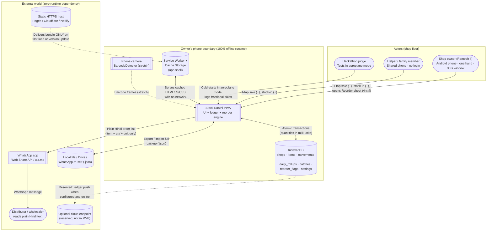

# 03 — System Context

## 1. Context diagram (C4 level 1)

**Core premise:** the app inside the phone's browser *is* the whole system at runtime. The static host is a delivery truck used once; after the Service Worker activates, the network can disappear and the shop keeps operating. Everything inside the "phone boundary" survives aeroplane mode; everything outside it is optional.

## 2. Actors and personas

| Actor | Primary goal | How they interact |
|---|---|---|
| Shop owner (दुकानदार) | Never run out of fast movers on Saturday evening; stop locking cash in dead stock | Logs sales and stock-ins one-handed in seconds; opens the Reorder sheet; sends the order to the distributor |
| Helper / family member | Keep logging sales while the owner handles cash or steps away | Same screen on the same phone; no accounts, passwords or role switching |
| Chemist (secondary owner) | Avoid loss from expired strips on the shelf | Optional expiry (month/year) on stock-in; checks the "जल्द एक्सपायर" list *(stretch S3)* |
| Distributor (सप्लायर) | Receive an unambiguous, legible order | Reads a Hindi/English WhatsApp message on their own phone; never installs the app |
| Judge | Verify aeroplane-mode resilience, one-handed speed, fractional math and Hindi UX | Opens once online, switches to aeroplane mode, force-closes, cold-starts, tests the tap budget |

## 3. External systems, platform APIs and failure boundaries

| System / API | Direction | Used for | Required for MVP? | Offline / failure behaviour |
|---|---|---|---|---|
| Static HTTPS host | host → device | Delivering HTML, JS, CSS, manifest, Service Worker | Only at first visit and updates | Immune after first load; app boots from Cache Storage |
| Service Worker + Cache Storage | internal | Precaching the app shell | Yes (M) | Install fails loudly if any asset fails to cache; "ऑफलाइन तैयार ✓" shown only after `SW_READY` |
| IndexedDB | internal | All items, movements, settings | Yes (M) | If blocked (e.g. strict private mode), blocking message: "मेमोरी बंद है" |
| Persistent Storage API (`navigator.storage.persist()`) | internal | Reduce risk of OS/browser eviction | Yes (M) | Requested after first save; if denied, gentle warning plus backup nudge |
| **OS storage pressure** (Android) | environment | Browser may evict site data when the phone is low on space | Boundary, not a dependency | Mitigated by persist request, 7-day / 100-entry backup reminder, one-tap export |
| File export / import (Blob download, file picker) | device ↔ app | Backup and restore `.json` | Yes (M) | Schema validated before any write; corrupt file rejected with "यह बैकअप फ़ाइल सही नहीं है", no partial write |
| WhatsApp (Web Share API / `wa.me`) | app → WhatsApp | Sending the order list | Stretch (S2) | Fallback to clipboard copy ("कॉपी हो गया!"); WhatsApp queues the message if signal is dead |
| Camera + BarcodeDetector | camera → app | Scanning barcodes | Stretch (S4) | Permission asked only when the scan icon is tapped; denial falls back to the search bar |
| Optional cloud sync endpoint | app ↔ cloud | Cross-device / multi-branch sync | Not in MVP | Reserved contract only (06 §9); no UI or network calls in MVP |

## 4. Trust and privacy boundaries

1. **Device boundary (zero-leak default).** Items, stock levels, sales velocity and dead-stock value live only in the browser origin's IndexedDB. No telemetry, no analytics, no third-party requests. Data leaves the phone only when the owner taps *Share order* or *Export backup*.
2. **Code delivery boundary.** The static host is trusted solely to serve versioned static assets over HTTPS. No credentials, cookies or shop data are ever sent back to it.
3. **Distributor share boundary (commercial confidentiality).** The order text contains only shop name, date, item name, order quantity and unit (e.g. `चीनी — 20 किलो`). It **never** includes cost prices, margins, dead-stock value, current shelf counts or sales velocity. The owner previews the text before sending; nothing is auto-sent.
4. **Backup boundary.** Exported `.json` is plain, full-state JSON so the owner owns their data and can send it to their own WhatsApp or Drive as a free backup. Treat the file as sensitive.
5. **OS storage-eviction boundary.** The operating system, not the app, can reclaim storage under pressure. The app cannot fully prevent this, so it reduces the risk (persist request) and the impact (frequent, easy backups).

## 5. Core data flows

All local writes are **one IndexedDB transaction** touching the movement ledger, the cached item stock and the rollup together. This is what keeps taps under 100 ms (N-02) without summing 50,000 rows on every render.

| ID | Flow | Source → destination | Payload | Transaction and offline guarantee |
|---|---|---|---|---|
| D1 | Record sale (बिका) | Counter UI → IndexedDB | `item_id`, `qty_milli`, type `sale`, `ts` | Atomic: appends `movements` row, updates `items.stock_milli` and `last_sale_at`, increments `daily_rollups` |
| D2 | Add stock (माल आया) | Stock-in UI → IndexedDB | `item_id`, `qty_milli`, type `stock_in`, optional `expiry` (YYYY-MM) | Atomic: appends movement, increments `items.stock_milli`, creates/updates `batches` row if expiry tracked |
| D3 | Undo (वापस लें) | Undo toast → IndexedDB | `movement_id` of the last action (within the 6 s window) | Atomic: writes a compensating `void` movement and restores item stock and rollup; the original row is kept, so history stays truthful |
| D4 | Manual count fix (गिनती सुधार) | Item sheet → IndexedDB | `item_id`, `actual_milli` | Atomic: writes an `adjust` movement for the difference and updates `stock_milli`; **not** counted as a sale, so velocity is unaffected |
| D5 | Compute Reorder sheet (मंगाओ) | IndexedDB → reorder engine → UI | Read-only: items, `daily_rollups`, flags | Pure in-memory calculation, ≤ 300 ms for 1,000 items; yields Running low, Not moving and (stretch) Expiring soon, each with a plain Hindi reason |
| D6 | Share order on WhatsApp | Reorder UI → Web Share / `wa.me` | UTF-8 text: shop, date, item — qty unit | Local string build only; no prices or stock levels; works with no signal (WhatsApp queues) |
| D7 | Export / import backup | IndexedDB ↔ local `.json` | Schema version, shops, items, movements, batches, flags, settings | Export is a full snapshot. Import validates schema, ULID format, safe integers and size cap, then writes in a single transaction (merge by id, or replace after confirmation); any failure leaves data untouched |

## 6. Runtime environment assumptions

- **Reference hardware:** entry-level Android phone (2–3 GB RAM, low-tier CPU, 360×640 to 412×915 CSS px) on Chrome 100+. iOS Safari 16.4+ is best effort.
- **Physical environment:** bright glare, noise, one hand weighing goods or handing change. No reliance on audio cues; use visual and haptic feedback; high-contrast default theme.
- **Network reality:** offline is the default assumption, not an error state. The app never shows a blocking "you are offline" banner; the only network-related indicator is the small "ऑफलाइन तैयार ✓" badge.
- **Shared device:** the phone is often left on the counter for a helper. No logins or session timeouts that lock the screen mid-rush; an optional 4-digit app lock is a stretch feature.
- **Storage reality:** Android may evict site data under storage pressure (see §3, §4.5).
