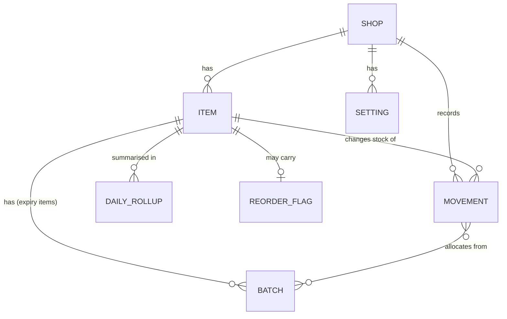

# 05 — Data Model

Storage: IndexedDB database `stocksaathi`. Schema versions are managed in `onupgradeneeded` (see §8).
Design goals, in order: **(1)** a sale is one fast atomic write, **(2)** the reorder sheet never scans the whole ledger, **(3)** numbers are forgiving (half kilos, dozens, loose pieces), **(4)** history is never silently rewritten.

## 1. Numeric rules (the trap)

- **All quantities are integers in milli-units of the item's base unit.** 1.5 kg = `1500` (base kg); 3 loose pieces = `3000` (base piece). A quantity must be a safe integer, `1 ≤ qty ≤ 1_000_000_000`.
- Base unit is one of `pc`, `kg`, `l`. Everything else is a *display unit* with a fixed factor:

| Display unit | Hindi | Base | Factor to base |
|---|---|---|---|
| piece | नग | pc | 1 |
| dozen | दर्जन | pc | 12 |
| packet | पैकेट | pc | 1 |
| kg | किलो | kg | 1 |
| g | ग्राम | kg | 0.001 |
| litre | लीटर | l | 1 |
| ml | मि.ली. | l | 0.001 |

- A **pack** (carton, पेटी, बोरी) is not a unit; it is an optional per-item `pack_size_milli` with a `pack_label`, used for order rounding and quick "+1 पेटी" presets.
- The quantity parser accepts `1.5`, `1,5`, `½`, `1/2`, `1 1/2`, `आधा`, `डेढ़`, `ढाई`, `दर्जन`, `आधा दर्जन`; it rejects anything below 1 milli-unit.
- Display trims trailing zeros (never more than 3 decimals); Hindi mode may render 500 milli-kg as "आधा किलो".
- Money is integer **paise**. Only used for "cash locked" estimates; never shared (see 03 §4).
- **Day keys** (`day`) are the device-local calendar date `YYYY-MM-DD` (IST on the reference phones), so "today's sales" match the owner's day, not UTC.

## 2. Entity overview



Starter packs are **static JSON bundled with the app**, not a database store (§6).

## 3. Object stores

### `shops`
| Field | Type | Notes |
|---|---|---|
| id | ULID | PK |
| name | string | Hindi or English |
| created_at | int (ms) | |
| archived | bool | |

MVP has exactly one shop; every other store still carries `shop_id` so multi-shop (S5) is not a migration.

### `items`
| Field | Type | Notes |
|---|---|---|
| id | ULID | PK |
| shop_id | string | |
| name | string | exactly as typed |
| search_tokens | string[] | **multiEntry index**; generated, see §5 |
| seed_key | string? | set when created from a starter pack; makes re-applying a pack idempotent |
| base_unit | `pc`\|`kg`\|`l` | immutable once the item has any movement |
| display_unit | string | unit the owner thinks in (kg, dozen, packet…) |
| default_sale_milli | int | amount for the 1-tap sale; default = 1 display unit |
| stock_milli | int | **cached projection**; may be negative |
| stock_verified | bool | `false` when stock was never counted (starter pack, lazy create) or a sale drove it below 0; `true` after `opening`, `adjust`, or an explicit count. UI shows a small "?" badge |
| pinned | bool | owner-pinned to the quick grid |
| min_milli | int? | optional manual threshold |
| lead_days | number? | falls back to shop setting |
| pack_size_milli | int? | order rounding |
| pack_label | string? | "पेटी", "बोरी", "carton" |
| price_paise | int? | per base unit; used for "cash locked" only |
| barcode | string? | stretch |
| track_expiry | bool | stretch (chemist) |
| archived | bool | soft delete |
| created_at, updated_at | int | |
| first_move_at | int? | start of observed data; drives confidence label |
| last_sale_at | int? | drives dead-stock check without scanning |

Indexes: `by_shop` (`shop_id`), `by_search` (`search_tokens`, multiEntry; results then filtered by `shop_id`), `by_shop_barcode` (`[shop_id, barcode]`, unique; items without a barcode are simply not indexed), `by_shop_last_sale` (`[shop_id, last_sale_at]`).

### `movements` — append-only ledger (source of truth)
| Field | Type | Notes |
|---|---|---|
| id | ULID | PK; time-sortable; makes retries idempotent |
| shop_id, item_id | string | |
| type | `sale`\|`stock_in`\|`opening`\|`adjust`\|`expiry_writeoff`\|`void` | `opening` = first count of an item, not a purchase |
| qty_milli | int | positive magnitude |
| sign | `-1`\|`+1` | sale and writeoff −1; stock_in and opening +1; adjust ±1; void is the opposite of the movement it reverses |
| ts | int (ms) | device clock; engine clamps future values to `now` |
| allocations | `{batch_id, qty_milli}[]`? | FEFO split for expiry items; lets undo restore exact batches |
| void_of | string? | id of the movement this reverses |
| device_id | string | for future sync |
| note | string? | rarely used |

Indexes: `by_item_ts` (`[item_id, ts]`), `by_shop_ts` (`[shop_id, ts]`), `by_void_of`.

**Invariant:** `items.stock_milli = Σ sign × qty_milli` over all movements of that item (voids included, because a void carries the opposite sign). The ledger is never edited or deleted from the UI.

### `daily_rollups` — derived cache, rebuildable
| Field | Type | Notes |
|---|---|---|
| item_id, day | `[item_id, day]` | PK |
| shop_id | string | |
| sold_milli | int | net quantity sold that day (voids subtract) |
| sale_count | int | number of sale taps that day (voids subtract); drives the quick grid |

Updated in the **same transaction** as each sale or void. The reorder engine reads up to 28 rows per item; the quick grid reads 14. Index: `by_shop_day` (`[shop_id, day]`).

### `batches` — expiry tracking (stretch S3)
| Field | Type | Notes |
|---|---|---|
| id | ULID | PK |
| shop_id, item_id | string | |
| expiry_ym | string `YYYY-MM` | a batch is valid through the **last day of that month** |
| qty_in_milli | int | |
| qty_left_milli | int | |
| received_at | int | |

Index: `by_item_expiry` (`[item_id, expiry_ym]`) — iterating it in order gives FEFO.
Rules: a sale of an expiry item consumes batches in `expiry_ym` ascending order and records the split in `movements.allocations`; any remainder beyond batch stock is left unallocated (stock goes negative, `stock_verified=false`). For `track_expiry` items, `Σ qty_left_milli ≤ stock_milli`; the difference is stock of unknown expiry.

### `reorder_flags`
| Field | Type | Notes |
|---|---|---|
| id | ULID | PK |
| shop_id, item_id | string | at most one active flag per item (`by_shop_item`) |
| kind | `ordered`\|`ignore` | |
| ordered_at | int? | set for `ordered` |
| qty_ordered_milli | int? | optional, what the owner actually ordered |
| until_ts | int? | `ordered` expires after `ordered_ttl_days` (default 7) so a missed delivery returns to the list |

`ordered` semantics: item leaves the Low list and appears in the **आने वाला माल** (incoming) strip. The flag clears automatically on the next `stock_in` for that item with `ts > ordered_at`, or when it expires, or when the owner taps "नहीं आया".

### `settings` (per shop key-value)
Keyed `[shop_id, key]`. Keys and defaults:

| Key | Default |
|---|---|
| language | `hi` (`hi`\|`en`\|`hinglish`) |
| default_lead_days | 2 |
| safety_days | 1 |
| cover_days | 7 |
| dead_after_days | 45 (30 for expiry items) |
| expiry_warn_days | 60 |
| ordered_ttl_days | 7 |
| undo_seconds | 6 |
| onboarded | false |
| starter_pack_applied | none |
| last_backup_at | none |
| entries_since_backup | 0 |
| device_id | generated once |

## 4. Derived values (never stored as truth)
`velocity`, `days_left`, `LOW`, `DEAD`, `suggest_qty`, `confidence`, `expiring`, `expired` are computed by `domain/reorder.ts` from `items`, `daily_rollups` and `batches` (formulas in 04 §6).

- **Confidence:** `low` if fewer than 7 days since `first_move_at`, `ok` for 7–27, `high` for ≥ 28.
- **Expiring:** a batch with `qty_left_milli > 0` whose last-day-of-`expiry_ym` is within `expiry_warn_days` of today. **Expired:** that date is already past; shown in red at the top of the sheet with a one-tap `expiry_writeoff`.
- **Quick grid order:** `pinned` items first, then by `Σ sale_count` over the last 14 days descending, ties by `last_sale_at`.

## 5. Search tokens
Generated on create/rename and stored in `search_tokens`:
1. Normalize to NFC, lower-case, strip punctuation, split into words.
2. For each word emit the word, its **Devanagari↔Roman transliteration** (चीनी → `cheeni`, `chini`; `sugar` ↔ `शुगर`), and every **prefix of length ≥ 2**.
3. Deduplicate; cap at 60 tokens per item.

A query is normalized the same way and looked up in `by_search`; results are filtered by `shop_id` and ranked by prefix-match, then quick-grid score. 1,000 items × ~25 tokens is a small index, and typing 2 letters already returns matches.

## 6. Starter packs and lazy onboarding
- Packs ship as bundled JSON (`kirana`, and stretch `chemist`, `hardware`, `stationery`), ~40 items each: `{ seed_key, name_hi, name_en, display_unit, base_unit, default_sale, pack_size?, pack_label?, track_expiry? }`.
- **Applying a pack** (offered on first run, also in Settings) creates items with `stock_milli = 0`, `stock_verified = false`, never overwrites an existing `seed_key`, and runs in one transaction. Re-applying adds only missing items.
- **Lazy item creation:** when a search returns nothing, the first row is "‘{text}’ नया सामान जोड़ें". It creates the item with only a name and unit; optional opening count is skipped by default.
- **Lazy stock count:** the first sale of an unverified item records instantly, then shows a non-blocking toast "कितना माल है? [गिनो]". It never delays the sale; ignoring it leaves the "?" badge.

## 7. Transaction recipes (each is exactly one IndexedDB transaction)

| Action | Stores touched | Steps |
|---|---|---|
| Sale | movements, items, daily_rollups, (batches) | allocate FEFO if `track_expiry`; append movement; `stock_milli −= qty`; set `last_sale_at`, `first_move_at`; rollup `sold_milli += qty`, `sale_count += 1`; if stock < 0 set `stock_verified=false` |
| Stock-in | movements, items, (batches), reorder_flags | append movement; `stock_milli += qty`; create/merge batch if expiry given; clear matching `ordered` flag |
| Opening count | movements, items | `opening` movement; `stock_verified=true` |
| Count fix | movements, items | `adjust` movement of `actual − stock_milli`; `stock_verified=true`; no rollup change |
| Undo | movements, items, daily_rollups, (batches) | append `void` movement (opposite sign, `void_of`); reverse stock, rollup and batch allocations; refuse if already voided |
| Expiry write-off | movements, items, batches | `expiry_writeoff` for the batch remainder; batch `qty_left = 0` |

Tile taps are **never debounced** (three quick taps are three real sales); only modal Save buttons carry a 300 ms lock, and every submit uses a pre-generated ULID so a retry cannot double-write.

## 8. Integrity, migrations, export
- `DB_VERSION = 1`. Every later version gets an explicit upgrade function; no destructive migration without an export prompt.
- **Integrity check** on launch for items touched in the last 7 days: recompute `stock_milli` from movements and batches from allocations; repair silently and log to console. A full rebuild of `daily_rollups` is available from Settings (hidden "मरम्मत").
- **Export format:** `{ app:"stocksaathi", schema:1, exported_at, shops[], items[], movements[], daily_rollups[], batches[], reorder_flags[], settings[] }`.
- **Import:** validates schema version, ULID format, safe integers, enum values, size ≤ 20 MB; merges by id in one transaction (or `replace` after confirmation); on any failure nothing is written. `daily_rollups` in the file are ignored and rebuilt from movements, so a tampered rollup cannot skew velocity.
- Capacity target: 100,000 movements ≈ 20 MB per shop, well under typical quotas.

## 9. Sample records

```json
// item (sugar, loose)
{ "id":"01J9ITEM…","shop_id":"01J8SHOP…","name":"चीनी (Sugar)",
  "search_tokens":["चीनी","ची","चीन","cheeni","chini","ch","che","chi","sugar","su","sug","suga"],
  "base_unit":"kg","display_unit":"kg","default_sale_milli":1000,
  "stock_milli":18500,"stock_verified":true,"lead_days":2,"pack_size_milli":50000,"pack_label":"बोरी" }

// sale of 1.5 kg
{ "id":"01J9MOVE…","item_id":"01J9ITEM…","type":"sale","qty_milli":1500,"sign":-1,"ts":1792568400000 }

// stock-in of 2 dozen eggs (base pc) with expiry
{ "type":"stock_in","qty_milli":24000,"sign":1,"allocations":null }
// batch: { "expiry_ym":"2026-12","qty_in_milli":24000,"qty_left_milli":24000 }

// ordered flag (shows in "आने वाला माल")
{ "item_id":"01J9ITEM…","kind":"ordered","ordered_at":1792570000000,"until_ts":1793174800000 }
```
